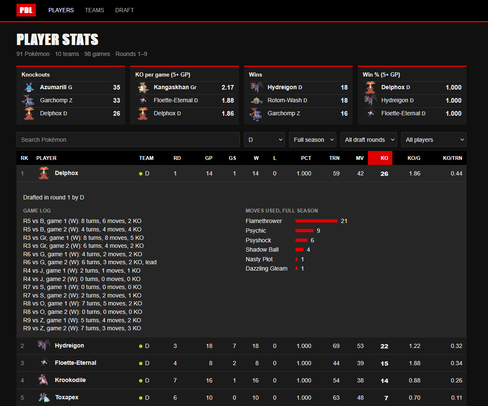
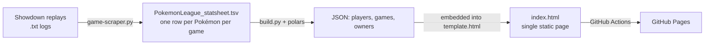

# Pokémon Draft League Dashboard

**Live dashboard: https://danielverd.github.io/pokemon-league/**

A stats dashboard for a ten-player Pokémon draft league. Every Pokémon, team and draft round can be sorted,
filtered by regular-season round, and drilled into for a per-game log.

[](https://danielverd.github.io/pokemon-league/)

## How it works



1. **Scrape.** `game-scraper.py` parses Pokémon Showdown battle logs into one row per Pokémon per game:
   turns on the field, moves used, knockouts, lead, result.
2. **Build.** `build.py` loads the sheet with polars and groups rows into a roster (draft round, original drafter,
   top moves, game log) and a deduplicated list of games with their winners. It warns if the two sides of a game
   disagree on who won.
3. **Render.** The JSON is inlined into `template.html`, producing one self-contained `index.html` with no backend.
4. **Deploy.** On every push that touches the data or the build, [the workflow](.github/workflows/pages.yml)
   rebuilds the page and publishes it to GitHub Pages. Updating the league means replacing the TSV and committing.

## Design decisions

- **A static page instead of Streamlit or a server.** The full season is about 100 games, so the whole dataset
  fits in the page. That means free hosting, instant interaction and nothing to keep running.
- **Per-game rows go to the browser, not pre-computed totals.** The page aggregates in JavaScript, so the same data
  powers the player, team and draft-round views and can be re-filtered to any range of rounds without a rebuild.
- **Matches are derived, not stored.** Best-of-three match results and standings are computed from individual
  game winners, so there is one source of truth.
- **Privacy by default.** The data identifies players only by initials. Display names are loaded from a private
  config (`PDL_NAMES` or a gitignored `names.local.json`), and any build that sees names writes
  `index.private.html` instead, so it can never overwrite the public page. The CI build never receives names.

## Running locally

```bash
pip install -r requirements.txt
python build.py          # writes index.html (initials only)
```

For a private copy with display names, create `names.local.json` (it is gitignored):

```json
{"A": "Alex", "Gr": "Grace"}
```

`python build.py` then writes `index.private.html`, which is also gitignored and is meant to be shared directly.

## Adding advanced stats

Custom metrics go in the `ADVANCED STATS` block near the top of the script in `template.html`. Each entry becomes
a sortable column in the views you list:

```js
const ADV=[
 {k:"kp10", label:"KO/10T", views:["players","teams","draft"], dec:2, fn:s=>s.turns ? 10*s.ko/s.turns : 0},
];
```

`fn` receives one table row's basic stats (`gp`, `gs`, `turns`, `moves`, `ko`, `w`, `l`, plus `gw`, `gl`,
`pkmn` in the team view) and returns a number.

## How this was built

The league, data collection and stat definitions are mine, as is the original game scraper.
I used Claude Code (Anthropic's AI coding assistant) to help write the build pipeline, the
GitHub Actions deployment, the Google Sheets fetch script and this README. I reviewed,
tested and adjusted that code, and I can explain it all.

## Disclaimer

Unofficial fan project, not affiliated with Nintendo, Game Freak or The Pokémon Company. Sprites are loaded from
[Pokémon Showdown](https://play.pokemonshowdown.com/). 
